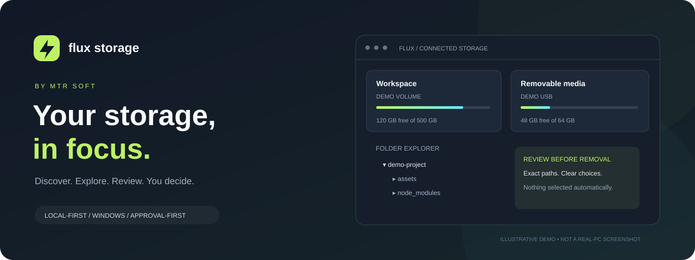

<div align="center">



# Your storage, in focus.

**Understand what takes space. Explore with confidence. Delete only what you approve.**

[](https://github.com/mtrakretech/flux-storage/actions/workflows/ci.yml)

[](LICENSE)


[Get started](#get-started) · [Features](#a-clearer-view-of-your-pc) · [Safety](#you-select-you-review-you-decide) · [Compatibility](docs/COMPATIBILITY.md) · [Release roadmap](docs/RELEASES.md)

</div>

---

## Less guesswork. More control.

**Flux Storage** is a local-first Windows storage explorer by **MTR Soft**. It combines a responsive browser interface, an expandable folder tree, clear cleanup classifications and an exact deletion manifest—without uploading your inventory to a service.

> **Unsigned development preview.** Current version: `2.2.0-dev.1`. The Releases page provides a custom setup EXE, per-user MSI and portable ZIP. The setup and portable files include the corrected Python runtime license payload; the MSI remains the earlier build because MSI install testing was explicitly skipped. Clean-machine compatibility, signing and broad hardware support are not claimed.

## A clearer view of your PC

| Discover | Explore | Take control |
| :--- | :--- | :--- |
| **Connected storage dashboard** with ready capacity, free space, filesystem, volume label and availability | **Explorer-style navigation** with lazy folder tree, list/icon views, breadcrumbs, editable scanned paths and Back/Forward/Up | **Approval-first cleanup** with three explicit permission modes |
| **Local and removable storage** including drive letters and Windows folder-mounted volumes | **Useful classifications** for caches, project dependencies, generated output and large files | **Exact deletion manifest** listing every descendant file and folder, searchable and exportable to CSV |
| **Responsive discovery** with bounded background device probes; network mappings listed without automatic probing | **Light, dark and system themes**, keyboard search, loading/empty/error states and mobile layout | **Live revalidation** of identity and metadata before removal, expiring previews and parent/child overlap collapse |

### Thoughtful defaults

- **Available ports, not port conflicts.** OS-assigned loopback port by default. Optional preferred port with automatic fallback. The active URL appears in the dashboard; the launcher rediscovers the running instance.
- **Preferences that survive a changing URL.** Theme, startup browser choice and preferred port are saved per Windows user.
- **No silent browser installation.** Use installed browsers first. An optional native chooser offers Edge, Chrome, Firefox or Brave through Windows Package Manager, with explicit consent. If winget is unavailable, setup explains the manual alternative.
- **No mandatory whole-drive rescan after each batch.** Review another known selection with a fresh live preview; historical totals stay labelled until rescanned.
- **Normal Windows boundaries.** Administrator access is requested through UAC. Flux does not disable security, take ownership or apply blanket permission changes.

## You select. You review. You decide.

Selecting a checkbox **never deletes anything**. Selections are independent of deletion permissions; blocked items are explained in the preview.

| Mode | What it permits | Required approval |
| :--- | :--- | :--- |
| **Recommended** | Recognized rebuildable cache/dependency/build targets, with restore/install markers where required | Fresh live preview + typed `DELETE` |
| **Advanced** | Intentional deletion of ordinary user files and folders, with additional sensitive-data protections | Administrator session + data-loss acknowledgement + typed `DELETE` |
| **Full control · risky** | Releases ordinary user-data restrictions, including credentials, signing keys, app data and browser profiles | Explicit session unlock with `ENABLE FULL CONTROL`, then a fresh preview + acknowledgement + `DELETE` |

> **Deletion is permanent—not the Recycle Bin. Back up important data first.** “Recommended” means recognized by policy, not proven unused or risk-free. Stop applications, builds and package managers before cleanup. Full control can destroy your only copy or break applications.

Critical OS/installed-app/runtime locations, volume roots and linked or incompletely inventoried trees remain blocked. Flux does not bypass Windows ACLs. Previews expire after five minutes. Metadata checks reduce stale-selection risks but are not an atomic filesystem transaction; concurrent changes can still cause partial failure. See [security and safety](SECURITY.md).

## Get started

### Pre-built preview (unsigned, from the Releases page)

Installers are preview builds — reviewed on the development machine and clean CI runners, still pending the full clean-machine compatibility matrix. **SmartScreen will show "Windows protected your PC"** because MTR Soft has not yet purchased a code-signing certificate; choose *More info → Run anyway* only after comparing the file with the published SHA-256 sums.

- **`FluxStorage-…-setup.exe`** — custom MTR Soft setup: license page, explicit destination selection (default: your `%LOCALAPPDATA%\Programs\Flux Storage`, no UAC for a per-user install; a machine-wide admin install is offered by the dialog when run elevated), Start-menu and optional desktop shortcuts, and an uninstaller that **keeps your `%LOCALAPPDATA%\FluxStorage` snapshots/history** by default, with an explicit prompt if you want them removed.
- **`FluxStorage-…-per-user.msi`** — standard Windows Installer package. The published MSI is unchanged from the previously tested build; it does not contain the latest runtime-license packaging correction. The corrected MSI candidate was built but not tested or published.
- **`FluxStorage-…-windows-x64-portable.zip`** — no install: extract anywhere and run `FluxStorage.exe`. Per-user state still lives in `%LOCALAPPDATA%\FluxStorage`; "portable binaries" does not mean portable data.

Not yet shipped: signed builds. No broad hardware-compatibility claim is made. See [docs/RELEASES.md](docs/RELEASES.md) and the [artifact component inventory](docs/ARTIFACT_INVENTORY.md) for validation status and packaging contents.

### Source checkout · Windows 10/11 x64

Requirements: **Python 3.12+**, **Bun 1.4.2+** for the UI build, a supported browser, and Windows administrator approval. Python 3.12–3.14 are the CI targets. Internet access is needed to fetch development dependencies; normal inventory/cleanup runs locally.

```powershell
git clone https://github.com/mtrakretech/flux-storage.git
cd flux-storage
python -m venv .venv
.\.venv\Scripts\python.exe -m pip install -r requirements.txt
```

Build the interface once (repeat after frontend changes):

```powershell
cd frontend
bun install --frozen-lockfile
bun run build
cd ..
```

Double-click **`Start Flux Storage.cmd`**, approve UAC and keep the server window open. Or run:

```powershell
.\.venv\Scripts\python.exe launch.py
```

If Flask is missing, the source bootstrap offers to create `.venv` and install dependencies **only after you approve**. It does not install Python, Bun or a browser silently; the packaged EXE/ZIP builds on the Releases page ship their own runtime.

### Your first scan

1. Choose a ready volume on the dashboard, or open **New scan** and enter a local folder.
2. Explore the completed inventory. Scan metadata does not establish whether a file is unused.
3. Select items, review blocked selections and inspect the exact deletion manifest.
4. Export the CSV if needed. Only confirm permanent removal when you understand every target.

Flux stores private local state under `%LOCALAPPDATA%\FluxStorage`. Scans/history are not stored in the checkout or published. Generated manifest artifacts contain paths and sizes, not file contents; old artifacts are pruned after seven days on startup. See [data, troubleshooting and support](docs/SUPPORT.md).

## Compatibility, without the fine-print surprises

- **Target:** Windows 10/11 x64. Windows 7/8.1, ARM64-native packages, Windows Server, macOS and Linux are not supported release targets.
- **Discovery:** accessible Windows-mounted local volumes, removable/USB media, optical and RAM drives where exposed by Windows. USB SSDs may appear as fixed drives. Duplicate volume mounts count once in dashboard totals.
- **Not a universal device reader:** mapped networks are listed but not scanned; raw/unmounted, locked, recovery, cloud-only and unavailable volumes cannot be inventoried. Elevated sessions may not see user drive mappings.
- **No SSD/HDD/SMART diagnosis.** Logical file sizes can differ from actual space reclaimed because of compression, sparse files, hardlinks and other concurrent activity.
- **Performance depends on storage and inventory size.** Background probes and paginated UI reduce blocking, but there is no “fast on any machine” guarantee. See [performance approach](docs/PERFORMANCE.md) and the [compatibility checklist](docs/COMPATIBILITY.md).

## Development & verification

```powershell
.\.venv\Scripts\python.exe -m pip install -r requirements-dev.txt
.\.venv\Scripts\python.exe -m unittest discover -s tests -v
.\.venv\Scripts\python.exe -m playwright install chromium
.\.venv\Scripts\python.exe tests/e2e.py
```

Browser tests start their own temporary fixture server on an available port. All test deletions are confined to freshly created fixture files—not your scans or personal folders. Windows CI builds the frontend and runs unit/browser checks. A passing CI run does **not** substitute for physical USB, Windows-version, installer or signing validation.

## What's next

The [release gates](docs/RELEASES.md) track the work before shipping **EXE + MSI + portable ZIP**: bundled runtime, MTR Soft setup UI, destination selection, shortcuts, uninstall/upgrade behavior, preservation of user data, signing and clean-machine testing. A manual draft-packaging workflow prepares an **unreleased** EXE/ZIP candidate; it does not publish a release or claim installer validation. MSI/custom setup is deliberately still planned.

## Built in the open

[Contributing](CONTRIBUTING.md) · [Security](SECURITY.md) · [Support](docs/SUPPORT.md) · [Third-party notices](THIRD_PARTY_NOTICES.md) · [Changelog](CHANGELOG.md)

MIT licensed. Product identity and original artwork by **MTR Soft**. Third-party components retain their own licenses. No affiliation with Microsoft or browser publishers is implied.

<div align="center"><sub>Flux Storage · MTR Soft · Local, private, approval-first.</sub></div>
